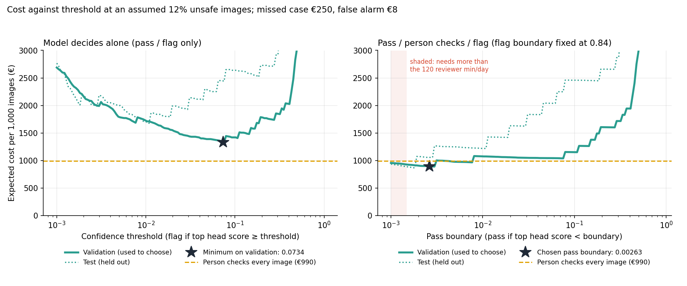
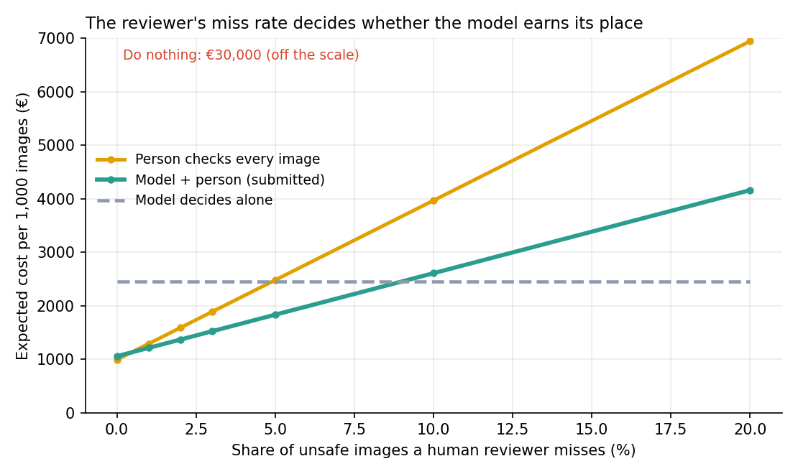

# Assignment 2 Report

- **Name**: Gonzalo Domínguez
- **Student ID**: 18691
- **Email**: gdominguez.ieu2022@student.ie.edu
- **Group**: BBADBA 5B

## Business problem, and the cost of being wrong

The business goal is to ensure every person within a construction site is wearing hard hats (for security reasons). To ensure this, cameras have been installed, and a site safety supervisor receives photographs periodically that check whether what the person being photographed is wearing a hard hat or not. The supervisor must decide which images need attention.

The model should thus read each photo and make one of 3 calls:
- Pass (there's no sign of an exposed head)
- Person checks (the evidence is weak, so the supervisor should look at the photo)
- Flag (strong evidence of a head being exposed — supervisor should intervene)

A positive case is an unsafe photo, that is, an image with at least one annotated exposed head (a possibly missing hard hat).

For the purposes of this project:
- FP: unnecessary check, a safe photo was flagged. It costs time and a little credibility.
- FN: a worker stays exposed and nobody knows, leading to potential investigations, litigation, and reputational costs.

Because of the asymmetry in effects, I went for a 31.25:1 ratio (250€ for a FN v. 8€ for a FP). These are illustrative and could be refined with further industry analysis, but have a base:
- 1 in every 200 uncorrectly exposed heads ends in an incident that costs 50k (0.5% of 50k = 250).
- About eight minutes of a supervisor's time, at 1€ a minute, = 8€

Each justified intervention has a related cost too of 2€, and each image revision has a related cost of 0.75 (45 seconds). As such, a reviewed image containing an exposed head would cost 2.75 (human review does not make intervention free).

Precisely because a miss costs around 330 times more than a human check does (250 v. 0.75), the pass boundary must sit at a very low score, so a photo will only be passed if there are close to no signs of an exposed head; and likewise since a flag is expensive when wrong and checking is cheap, flagging should only occur when the model is very sure. 

## Dataset

- Roboflow Universe workspace: joseph-nelson
- Project: hard-hat-workers
- Version: 10 (raw_AllClasses)
- Dataset: https://universe.roboflow.com/joseph-nelson/hard-hat-workers/dataset/10
- Task: Object detection
- Classes: head, helmet, person.

One image is a photo of a work scene with workers in it, `head` marking a bare head, `helmet` a head wearing a hard hat, and `person` a whole person.

This is a detection problem because the supervisor should be examining the actual head/helmet box, and if an image shows many different workers with protected and unprotected heads, a single class for the whole image is too simple.

In containing both labeled hads and helmets in workers scenes, and having train, val and test partitions differentiated, the dataset seemed very relevant to the business problem of insecurity in the work scene. 

## What the dataset's composition implies

| Split | Images | `head` boxes | `helmet` boxes | `person` boxes | Images with ≥1 `head` |
|---|---:|---:|---:|---:|---:|
| train | 4,916 | 4,612 | 13,919 | 450 | 911 (18.5%) |
| val | 1,413 | 1,339 | 3,913 | 101 | 256 (18.1%) |
| test | 706 | 726 | 1,915 | 64 | 140 (19.8%) |

- The positive rate is consistent across splits (18.1% - 19.8%), so the test split is not hard nor easy.
- I assume 12% for the cost model (which is lower than the dataset's 18-20%) and will re-weight the results to it. Will be testing extremes (2 and 30%)
- One image is 0.7 points of recall. In euros, one missed test image moves the cost by about €214 per 1,000 photos (1000 × 0.12 × 250 / 140)
- There are no byte-identical images in more than one split (proven by a SHA-256 comparison), but near-duplicates (frames from the same camera that are video-adjacent) are still a prominent risk
- `person` has 450 training and 64 test boxes, against tens of thousands for `helmet`. The decision cannot in good faith make solid use of `person`.
- A typical `head` box is about 49 pixels, and the smallest are about 30; so I cannot shrink the 640-pixel mages any further even if I wanted to speed up training.
- Accuracy is not a reliable measure since the "always pass" rule would score 80.2% on the test split.

## Finetuning and baselines

I fine-tuned YOLO11s starting from the pretrained yolo11s.pt checkpoint rather than random weights. s is preferred over n to deal with the small objects. No architecture search was conducted.

    Note: train.ipynb was ran on Google Colab using T4 GPU. `weights` and `artifacts` were both copied from there. It is apparently likely that running `main.py train` on different hardware may give slightly different numbers.

- Settings: 30 epochs (mosaic augmentation switched off for epochs 21-30), image size 640, batch 16, deterministic, early-stopping patience 8 (untriggered).
- System choices: Ultralytics chose the optimiser (AdamW with a LR of .0014) and standard augmentation, with mixed precision on
- Confidence floor at .001, NMS IoU .7, batches of 4 images done so as to avoid GPU memory failures. 

The validation mAP50 over epochs 26-30 was fluctuating around .66 and .662, so it had leveled off (more epochs would be unlikely to  help). 

All three models below are scored on the same  test split with the same scorer, at an IoU of .5 for AP50.

| Model | `head` AP50 | `helmet` AP50 | `person` AP50 | Mean AP50 | mAP50–95 |
|---|---:|---:|---:|---:|---:|
| **YOLO11s finetuned** | **0.959** | **0.979** | 0.031 | **0.657** | **0.459** |
| YOLO11s COCO zero-shot (only `person` mapped) | 0.000 | 0.000 | 0.038 | 0.013 | 0.009 |
| Predict nothing | 0.000 | 0.000 | 0.000 | 0.000 | 0.000 |

The finetuned model beats both baselines comfortably. 
- The predict nothing baseline costs 30k per 1000 photos (at my assumed rate), compared to about 1,054€ for the model + a person.
- COCO has no head or helmet class, so the only way to map it is its person class. In that class, COCO model is better than my finetuned model (.038 v. .031), which is a labeling issue (COCO also makes almost 3000 other person detections that the labels do not contains). 

## Per-class evaluation and failure modes

- **Positive class**: `head` (an exposed head).
- **Headline class**: `head`, with AP50 0.959, since it's the class the business decision depends on. `helmet` is higher (0.979), but a helmet detection does not trigger an action.

| Class | Test GT boxes | Precision @ 0.25 | Recall @ 0.25 | AP50 | mAP50–95 |
|---|---:|---:|---:|---:|---:|
| **`head`** | 726 | 0.8965 | 0.9545 | **0.9591** | 0.6719 |
| `helmet` | 1,915 | 0.9242 | 0.9671 | **0.9792** | 0.6882 |
| `person` | 64 | 0.0000 | 0.0000 | 0.0314 | 0.0170 |
| Mean | | | | 0.6566 | 0.4590 |

The mean of .657 is caused by a near empty class, since head and helmet average .96. 

Object-level confusion matrix on the test split (same settings):

| Actual / Predicted | `head` | `helmet` | `person` | Background (missed) |
|---|---:|---:|---:|---:|
| `head` | 693 | 13 | 0 | **20** |
| `helmet` | 4 | 1,852 | 0 | **59** |
| `person` | 0 | 0 | 0 | **64** |
| Background (unmatched prediction) | **76** | **139** | 0 | — |

From this matrix, it is proven:
- Heads are very rarely confused with helmets (which causes massive issues), with only 13 real heads being called helmets and 4 helmets called heads. 33 of 726 heads are not seen as heads.
- 76 predicted heads do not match any label, which limits head precision and it's why the flag boundary must be high
- `person` fails at .25, but since it does not feed the decision it's irrelevant for the cost.

It should be noted however that, of the 140 unsafe test photos, my final policy passes 3 of them, and in them all the model reports a helmet with score .85 or higher and no head score. These files are listed in artifacts.

In validation, the 4 missed unsafe photos also have head scores of 0. Thus, the misses still present are not borderline cases, proving the threshold works. 

No other error sources (such as small obejcts or crowded scenes) can be proven from the available evidence.

## Cost matrix and operating point

*Refer to section 1 for the cost table*

    Disclaimer on assumptions: I assume 12% of photos are unsafe, which is lower than the dataset's 18-20% as explained above. I assume the site sends 600 photos a day, that a check takes 45 seconds, and that the supervisor can give 2 hours a day to check photos, which covers 160 photos. These are reasonable numbers that have no data to back them up, but are sourced from my reasonable estimates and finetuned with AI to try and avoid personal bias.

Say the model's score was a probability *p* of an unsafe photo. The costs would then fix the threshold as follows:
- Pass is better than sending to a person when *p* × 250 < 0.75 + *p* × 2, = *p* < 0.0030.
- Flag is better than sending to a person when (1 − *p*) × 8 < 0.75, = *p* > 0.906.

These are not used directly but rather work as checks that the threshold must be very low and very high for passing and flagging respectively. 

The sweep finds the real values. I picked thresholds on the val split and evaluated them on the test split. For each pair, I computed the confusion matrix by outcome, re-weighted to 12% unsafe, and priced it. 
- The review boundaries were searched over more than 2000 pass/flag pairs.

The model alone (left panel) shows that the best single threshold is 0.0734, with an expected cost of €1,333 per 1,000 photos on validation. 
- On the test split the same threshold costs 2,452€, because 9 of 140 unsafe photos are missed there v. 2.3% on validation. 

The pass/check/flag (right panel) finds the optimum to be pass below 0.00263, and flag at 0.84 or above. 
- It costs 892€ per 1,000 photos on validation and 1,054€ on the test split, and it sends 20.3% of photos to a person (re-weighted to 12% unsafe; the raw test split sends 23%). 
- A photo where neither the head nor the helmet score reaches 0.25 is always sent to a person (this rule actually only affects 2 photos)

1054€ distribution (test split per 1,000 photos)

| Part | € | Could a threshold change it? |
|---|---:|---|
| Interventions on real cases (2€ × about 117 caught unsafe photos) | 235 | No, it is paid for every case caught |
| Missed unsafe photos (3 of 140) | 643 | Only partly (see below) |
| Human checks (20.3% × 0.75€) | 152 | Yes, it trades against misses |
| False alarms (2 safe photos flagged) | 25 | Yes |

2 of the 3 misses have head scores of 0 (no threshold could recover them) and are worth about 429 of the 643€.

On the test split, a bootstrap over the 706 photos gives a 95% interval of 419 to 1855€ for the final policy. The difference from "model alone" goes from 465 to 2,433 euros saved, so even with this small test split the policy is cheaper than the model alone.

However, it is not necessarily the cheapest: if a person checked every image and never made a mistake it would cost 64€ less than the policy, so against a perfect reviewer, the model loses. The decision comes down to the following assumptions:

| Assumption | My value | The policy beats "person checks all" if | The policy beats "model alone" if |
|---|---|---|---|
| Share of unsafe photos a reviewer misses | 0% | the reviewer misses more than 0.45% | the reviewer misses less than 9.0 |
| Cost of a missed photo | 250€ | it is below about 225€ | any value from €25 to €1,000 |
| Share of unsafe photos | 12% | it is below about 10.9% | any value from 2% to 30% |
| Cost of a human check | 0.75€ | it is above about 0.83€ | — |

I genuinely do not believe a person would miss fewer than 1 in 200 unsafe photos, it being a crazily repetitive and mentally exhausting job, so the dashboard includes a slider for it.

A lower check cost would help "person checks all" more than it would my policy (at .4 a check, person checks all saves 344 euros against the policy). The TP cost does not change thresholds and barely changes the ranking.

## What a person still has to check

As explained above, a person checks anything in between the thresholds (.00263 -> .84)

Workload at 600 photos a day and the assumed 12% unsafe (72 unsafe photos a day):

| | Per day |
|---|---:|
| Passed automatically | about 444 |
| Sent to a person | around 122 (20.3%) |
| Flagged | about 35 (33 of them that are truly unsafe) |
| Unsafe photos passed by mistake | about 1.5 |

At 45 seconds a check, these 122 checks take 91 minutes a day, which fits the previously outlined budget — no hiring is needed, the supervisor can take care of it.

Since about 3 in every 10 photos checked a person does not actually contain an exposed head, we are not wasting time. If more than about 30% of the photos were unsafe, the queue would exceed 160 photos a day. 

122 checks over a working day is about one every 4 minute, and 1 flag every 14 minutes. When priced against alternatives:

| Way of working | Cost per 1,000 photos | Cost per day | Reviewer time per day | People | Unsafe photos missed per day |
|---|---:|---:|---:|---:|---:|
| Do nothing | 30,000€ | 18,000€ | 0 | 0 | 72 |
| Model decides alone (threshold 0.0734) | 2,452€ | 1,471€ | 0 | 0 | 4.6 |
| Person checks every photo | 990€ | 594€ | 450 min | **1.0, full time** | 0 (assumption) |
| **Model + person (submitted)** | **1,054€** | **633€** | **91 min** | **0.20** | 1.5 |

While person checks every photo with a perfect reviewer is cheaper (at about 39€ a day), I would still recommend my model because it actually fits the available time, and the previously outlined lack of realism of a perfect reviewer.

This policy would stop being better if the reviewer misses more than 9% of unsafe photos (the model alone would be cheaper), but then the actual problem is the reviewing process.

## Limitations & next steps

All of these limitations have been thoroughly commented upon during the report, so this serves as a summary of them all.

- The costs are entirely illustrative, so we would have to go to the site's incident and insurance records, take the missed-case costs, and the review time from timing real reviews.
- The reviewer's miss rate is assumed to be zero, which should actually be measured by slipping known-to-be unsafe pics into the review queue to properly check effectiveness.
- Misses are photos where the model cannot see any heads, so they are not fixable via thresholds. The specific photos (3 test 4 val) should be opened to check whether they are labeling errors or extremely hard scenes — in the latter case, we could try a larger input size for the small heads.
- The test split is very small and it may still contain near-duplicates. A logical next step would be to collect more unsafe photos so that we could split by camera and/or site, and not just by image.
- The base rate and the photos may not match a real site (the dataset is 18-20% unsafe and I assumed 12% and I have not tested for night photos, climate conditions, broken cameras...), so the obvious next step would be to label a wekk of real photos from the site and monitor what is the share actually sent to a person.
- If a miss is caught in the immediate next image, it would lower the real cost of a miss — photos are treated as independent cases when they are likely not.
- `person` is entirely unusable, dragging the mean AP50 down. 

## Generative AI use disclosure

AI was used for 5 different purposes:
1. **Code refinement**: more complex and detailed parts of the code were produced by AI, starting off of a baseline created by me.
2. **App development**: the Gradio app is 99% created by AI, as authorised in-class by the instructor — I pulled off a very basic iteration of it by hand but I would have never been able to do it without it.
3. **Completionism**: While evaluating potential improvements, AI came up with a couple good ideas that it helped explain and then implement. This includes the SHA-256 comparison, cost arrangements, etc.
4. **Report formatting cleanup**: for a better understanding of markdown format and also better visibility, AI was used to identify areas where the format's legibility could be improved. The most prominent case of this are the tables, which use the format and headers recommended by AI; and also the inclusion of figures into the folder to incorporate into the report.
5. **Proper functionality**: identification and understanding of errors in-code and during running, learning how to properly commit, etc.
